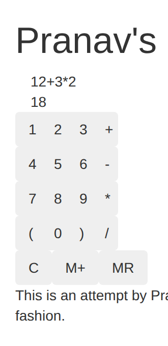
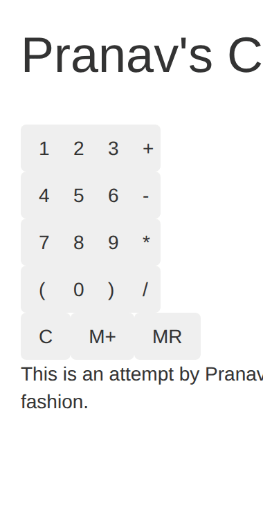

# ReactCalculator

A calculator Pranav Prem built in React on October 31, 2017. Button presses append to an expression and the value updates immediately. There is no equals key.



## Original context

The first commit that day is a working keypad. A later commit the same afternoon makes it look a bit better and adds the screenshot that used to live at `Calc.png`. The header still says "Pranav's Calculator," and the footer is still his one-line description of the attempt.

The original `package.json` was named `react-tutorials` and used Babel 6 with `babel-plugin-react-html-attrs`, `transform-decorators-legacy`, and `stage-0`. That is the webpack and React starter from the mid-2010s LearnCode.academy tutorials. The calculator was built on top of that starter and left on React 0.14 and Webpack 1.

On December 29, 2020 the dev server was bound to `0.0.0.0` and its host check was turned off so the app could run on EC2. That change matches [ReactDeployer](https://github.com/pranavprem/ReactDeployer), Terraform from the same period that clones one of Pranav's React repos, runs `npm install` and `npm run dev`, and puts the process behind a load balancer on port 8080. ReactCalculator is the default `repo_name` in that project.

## How it works

The keypad only inserts tokens: digits, `+ - * /`, parentheses, `C`, `M+`, and `MR`.

Each click rebuilds the expression and evaluates it with JavaScript, so operator precedence is JavaScript's. `12+3*2` is 18. Parentheses work: `(12+3)*2` is 30. An unfinished expression such as `12+` is left on screen and the previous value stays.

`C` clears the expression and the value. It does not clear memory.

`M+` stores the current value, then clears the screen. `MR` pastes the stored value onto the end of the expression. A stored zero is pasted as `0`, and a stored negative number is pasted with its sign, so `3+` then memory `-1` becomes `3+-1`.

## Run it today

Node.js 22.15 or newer. Node 22 is in maintenance LTS through April 2027. Node 24 is the active LTS as of October 2026. `.nvmrc` says `22`. CI installs the current Node 22, which is past 22.15. Webpack Dev Server 6 does not start on older 22.x releases.

```bash
npm ci
npm run dev
```

Open [http://127.0.0.1:8080/](http://127.0.0.1:8080/). The server listens on all interfaces so a load balancer can reach it.

```bash
npm test             # calculator behavior
npm run lint
npm run format:check
npm run build        # writes dist/index.html and dist/client.min.js
```

The production build is a static page. ReactDeployer does not use it; it runs the dev server. Serving `dist/` yourself is fine if you want to skip the dev server.

## Tech stack

- React 19, rendered with `createRoot`. The UI is still class components.
- Webpack 5 and Webpack Dev Server 5, with Babel for JSX.
- Bootstrap 3.3.7 from the Bootstrap CDN, for the same classes the 2017 page used.
- Node's built-in test runner, ESLint 10, and Prettier.
- GitHub Actions on the current Node 22.

Versions are pinned in `package.json` and locked in `package-lock.json`.

## Project structure

```
src/index.html                         page shell and Bootstrap CSS
src/js/client.js                       React entry
src/js/calculator.js                   expression, result, and memory
src/js/components/Layout.js            state and wiring
src/js/components/Calculator.js        keypad rows
src/js/components/Calculator/CalcElement.js
src/js/components/Result.js            expression and value
src/js/components/Header.js
src/js/components/Footer.js
test/calculator.test.js
webpack.config.cjs
.github/workflows/ci.yml
```

`CalcElement` still lives in a nested `Calculator/` folder. That was the original layout.

## ReactDeployer

`npm run dev` is still the start command, and it still serves HTTP 200 on port 8080 from `0.0.0.0`. The dev server accepts any `Host` header, which is what the load balancer health check needs.

Two things about that deploy are different now:

- The dev script is no longer `webpack-dev-server --content-base src --inline --hot --host 0.0.0.0`. That CLI is gone, and Webpack Dev Server 6 does not accept `--host` or `--port` on the command line either. `npm run dev` is `webpack serve --mode development`. It still binds `0.0.0.0:8080` because `webpack.config.cjs` says so. ReactDeployer only runs `npm run dev`.
- A production bundle used to be emitted as `src/client.min.js`. `npm run build` now writes `dist/index.html` and `dist/client.min.js`. The dev server does not depend on that file.
- The EC2 user-data script installs Node from Ubuntu's `apt` repository. That Node is too old to install or start this project. Install Node.js 22.15 or newer before `npm install`.

## Demo



## For agents

[AGENTS.md](./AGENTS.md) is the guide for working in this repo. [CLAUDE.md](./CLAUDE.md) points at it.
